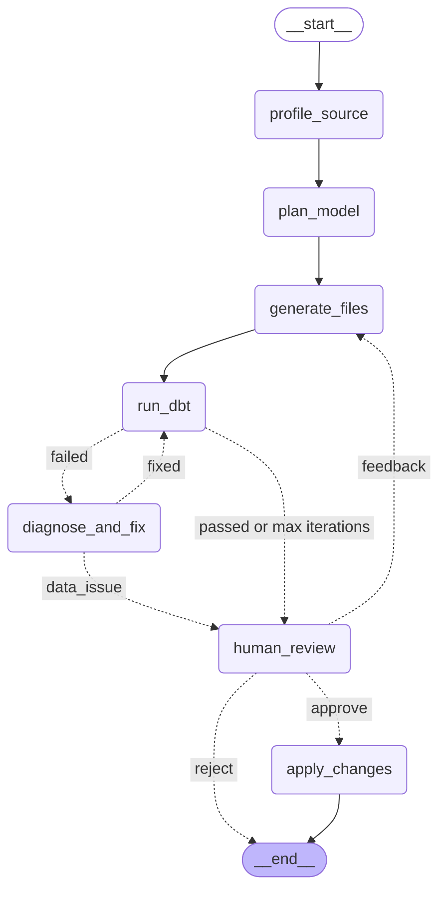

# dbt Pipeline Builder Agent

Describe a CSV in plain language, for example "orders.csv, loaded daily, one row per order". A LangGraph
agent then:

1. profiles the file,
2. writes a dbt staging model with tests and docs,
3. runs `dbt build`,
4. reads any errors and fixes its own code until the build passes.

You review the diff and approve it before anything is written into your dbt project.

## The problem

Onboarding a new raw source into dbt is repetitive: rename columns to snake_case, cast types, work out
the grain, add `unique`/`not_null`/`accepted_values`/`relationships` tests, document every column, and
wire up the source. Then you go back and forth with `dbt build` until it passes. An agent can do that
loop well. It must not "fix" a failing test by deleting it when the test caught bad data, and a human
still decides what ships.

## The graph

Exported with `python -m agent graph` (LangGraph's `draw_mermaid`):



| Node | LLM? | What it does |
|---|---|---|
| `profile_source` | no | Reads the CSV with DuckDB. Reports columns, inferred types, null rates, distinct counts, values of low-cardinality columns, duplicated IDs, a candidate primary key and sample rows. |
| `plan_model` | yes | Proposes snake_case names, a DuckDB type per column, the primary key and tests. It can add a `relationships` test only to a `dim_*` model that already exists in the project. The plan is checked against the real CSV columns. |
| `generate_files` | first round: no; feedback round: yes | Renders `stg_<name>.sql`, `_<name>__models.yml` and `_<name>__sources.yml` into a sandbox copy of the dbt project (`.sandbox/<thread_id>/`). After reviewer feedback, the LLM revises these files instead. |
| `run_dbt` | no | Runs `dbt build --select stg_<name>` in the sandbox and parses `run_results.json` and `manifest.json`. |
| `diagnose_and_fix` | yes | Reads the error and the error history, then either replaces **one** file (with a one-line explanation) or reports a data issue. |
| `human_review` | no | LangGraph `interrupt()` with the full diff, test results, fix history and data issues. You resume it with approve, reject or free-text feedback. |
| `apply_changes` | no | Copies the approved files into `dbt_project/`. |

After 5 `dbt build` attempts without a pass, the loop stops and the run goes to review with status
`needs_help`. Every step is checkpointed in Postgres, so a run survives restarts and you can resume it
from another shell.

### The data-issue rule

A data test that fails because the source data really is bad must not be "fixed". The fix prompt
(`agent/prompts.py`, `FIX_SYSTEM`) says so explicitly. Code enforces it too: `guard_against_hiding` in
`agent/nodes/fix.py` refuses any edit that does one of the following while a data test is failing:

- removes the failing test,
- weakens it (`severity: warn`, `where`, `error_if`, ...),
- adds row filters or deduplication to the SQL.

A refused edit becomes a data-issue flag for the reviewer.

## Quickstart

```bash
make setup            # venv + dependencies, creates .env; then put ANTHROPIC_API_KEY in .env
make up               # Postgres (checkpoints) + self-hosted Langfuse at http://localhost:3000
make demo             # runs orders, customers and payments
```

Other commands:

```bash
python -m agent build data/orders.csv "orders, loaded daily, one row per order"
python -m agent resume <thread_id>                 # re-shows the pending review, or continues a crashed run
python -m agent resume <thread_id> --decision approve
python -m agent build data/orders.csv "..." --decision "rename amount to order_total"   # non-interactive
make test
```

At the review prompt, type `approve`, `reject`, or any other text. Anything else counts as feedback
and starts another round (`human_review → generate_files → run_dbt → ...`). Without a terminal (for
example in CI), the CLI leaves the run paused and prints the `resume` command.

## What the demo does

| Source | What is special about it | Expected outcome |
|---|---|---|
| `data/orders.csv` | Clean. `customer_id` references the existing `dim_customers`. | Passes on the first build, including a `relationships` test to `dim_customers`. |
| `data/customers.csv` | Messy headers (`Customer ID`, `E-mail Address`, `SignupDate`, `Is Active`) and mixed date formats. The first 12 rows are ISO, so the sample rows look clean. | The first build fails on the date cast. The agent rewrites the SQL to parse both formats and the second build passes. |
| `data/payments.csv` | Two duplicated `payment_id` values. | The `unique` test fails. The agent flags a data issue and the test stays in the YAML. |

The seed dbt project (`dbt_project/`) has one mart, `dim_customers`, built from a seed. That gives the
planner a known dimension for `relationships` tests.

## Sample run: failure and self-fix

The log below is real CLI and dbt output. The two LLM answers in it (the plan and the fix) came from the
scripted model used in `tests/`, so Claude's wording will differ.

```text
$ python -m agent build data/customers.csv "customers exported from the CRM, loaded daily, one row per customer" --decision approve
thread_id: customers-d99126c4
[profile_source] profiled customers.csv: 20 rows, 7 columns, candidate primary key: Customer ID
[plan_model] planned 7 columns, primary key customer_id, 6 tests
[generate_files] wrote models/staging/stg_customers.sql
[generate_files] wrote models/staging/_customers__models.yml
[generate_files] wrote models/staging/_customers__sources.yml
[run_dbt] [FAIL] iteration 1: dbt build --select stg_customers  (PASS=0 WARN=0 ERROR=1 SKIP=6 NO-OP=0 REUSED=0 TOTAL=7)
[run_dbt]     ERROR stg_customers: Conversion Error: invalid date field format: "05/14/2024", expected format is (YYYY-MM-DD) when casting from source column SignupDate
[diagnose_and_fix] fix (models/staging/stg_customers.sql): SignupDate mixes YYYY-MM-DD and MM/DD/YYYY; parse both formats explicitly with try_strptime
[run_dbt] [PASS] iteration 2: dbt build --select stg_customers  (PASS=7 WARN=0 ERROR=0 SKIP=0 NO-OP=0 REUSED=0 TOTAL=7)
==============================================================================
REVIEW  thread=customers-d99126c4  source=customers  status=PASSED
dbt: PASS=7 WARN=0 ERROR=0 SKIP=0 NO-OP=0 REUSED=0 TOTAL=7  (after 2 build(s))
==============================================================================
Fix history:
  - iteration 1: code_fix [models/staging/stg_customers.sql]: SignupDate mixes YYYY-MM-DD and MM/DD/YYYY; parse both formats explicitly with try_strptime

Test results:
  SUCCESS  model  stg_customers
  PASS     test   accepted_values_stg_customers_country_code__DE__FR__GB__MA__US
  PASS     test   not_null_stg_customers_email
  PASS     test   not_null_stg_customers_customer_id
  PASS     test   not_null_stg_customers_is_active
  PASS     test   not_null_stg_customers_signup_date
  PASS     test   unique_stg_customers_customer_id

Diff against the dbt project:
(... _customers__models.yml and _customers__sources.yml, shown in full by the CLI ...)
--- /dev/null
+++ b/models/staging/stg_customers.sql
@@ -0,0 +1,22 @@
+with source as (
+
+    select * from {{ source('raw_customers', 'customers') }}
+
+),
+
+renamed as (
+
+    select
+        cast("Customer ID" as integer) as customer_id,
+        "First Name" as first_name,
+        "Last Name" as last_name,
+        "E-mail Address" as email,
+        coalesce(try_strptime("SignupDate", '%Y-%m-%d'), try_strptime("SignupDate", '%m/%d/%Y'))::date as signup_date,
+        "Country" as country_code,
+        cast("Is Active" as boolean) as is_active
+    from source
+
+)
+
+select * from renamed
==============================================================================
[human_review] review decision: approve
[apply_changes] applied dbt_project/models/staging/stg_customers.sql
[apply_changes] applied dbt_project/models/staging/_customers__models.yml
[apply_changes] applied dbt_project/models/staging/_customers__sources.yml
run customers-d99126c4 finished with status APPLIED
```

## Data-issue example

```text
$ python -m agent build data/payments.csv "payments, loaded hourly, one row per payment"
[profile_source] profiled payments.csv: 38 rows, 5 columns, candidate primary key: none
[plan_model] planned 5 columns, primary key payment_id, 6 tests
...
[run_dbt] [FAIL] iteration 1: dbt build --select stg_payments  (PASS=6 WARN=0 ERROR=1 SKIP=0 NO-OP=0 REUSED=0 TOTAL=7)
[run_dbt]     FAIL unique_stg_payments_payment_id: Got 2 results, configured to fail if != 0
[diagnose_and_fix] DATA ISSUE: payments.csv has 2 duplicated payment_id values (5007, 5020); the grain 'one row per payment' is violated upstream
==============================================================================
REVIEW  thread=payments-3988a0ee  source=payments  status=DATA_ISSUE
dbt: PASS=6 WARN=0 ERROR=1 SKIP=0 NO-OP=0 REUSED=0 TOTAL=7  (after 1 build(s))
==============================================================================
DATA ISSUES (tests kept; the source data needs attention):
  ! payments.csv has 2 duplicated payment_id values (5007, 5020); the grain 'one row per payment' is violated upstream
  ! unique_stg_payments_payment_id: Got 2 results, configured to fail if != 0
...
  FAIL     test   unique_stg_payments_payment_id
```

The generated `_payments__models.yml` still has `unique` on `payment_id`. From here the reviewer can
reject the model, approve it anyway (the failing test then documents the problem in the project), or
send feedback such as "keep the latest row per payment_id and document why". Feedback from the
reviewer is allowed to change behaviour. The fixer alone is not.

## Tracing (Langfuse)

`make up` starts a self-hosted Langfuse v3 stack: web, worker, ClickHouse, Redis and MinIO, sharing the
Postgres container. The headless init creates a project with the API keys that are already in
`.env.example`. Log in at http://localhost:3000 as `admin@example.com` / `admin-password`. Each run is
one Langfuse session named after its `thread_id`, with the plan, fix and revision LLM calls nested under
the graph nodes. Clear `LANGFUSE_PUBLIC_KEY` in `.env` to turn tracing off.


## Tests

`make test` runs:

| File | What it covers |
|---|---|
| `tests/test_graph.py` | The graph compiles; the routers; pass → review → apply; fail → fix → dbt; reject; feedback → another round. The LLM and dbt are mocked. |
| `tests/test_max_iterations.py` | The loop stops after 5 builds with status `needs_help`, and the cap is configurable. |
| `tests/test_data_issue.py` | Real dbt on `payments.csv`. An honest LLM flags the issue; an LLM that deletes the test, or dedupes in SQL, is overruled. Every case ends in review with the `unique` test still present. |
| `tests/test_dbt_flows.py` | Real dbt: `orders` passes and the applied project builds; `customers` self-corrects the date cast. |
| `tests/test_resume.py` | Stop at the interrupt, rebuild the graph from scratch, resume from the checkpoint. Runs in memory, and against Postgres when it is reachable. |
| `tests/test_integration.py` | End to end on `orders.csv` with the real Claude model. Marked `integration`; skipped without `ANTHROPIC_API_KEY`. |

## Layout

```
agent/
  cli.py          build / resume / graph commands, review prompt
  graph.py        StateGraph wiring and routers
  state.py        PipelineState
  prompts.py      plan, fix and revise prompts (the data-issue rule lives here)
  schemas.py      structured outputs (ModelPlan, FixDecision, Revision)
  nodes/          one module per node
  dbt_runner.py   runs dbt in a sandbox, parses run_results/manifest
  project.py      sandbox copies, diffs, known dimensions
dbt_project/      seed project: customer_master seed + dim_customers
data/             orders.csv, customers.csv, payments.csv
tests/
```

## Limitations

- **CSV sources and DuckDB only.** Sources are read with `read_csv(..., all_varchar = true)` through
  dbt-duckdb's `external_location`, and the staging model owns every cast. Other warehouses would need
  a different source template.
- **CSV location.** Generated sources point at `{{ env_var('PIPELINE_DATA_DIR', '../data') }}/<file>`
  when the CSV is in `data/`. A CSV elsewhere is referenced by absolute path, which does not travel
  well.
- **Samples can mislead.** The planner sees profile statistics and the first 5 rows, not the whole
  file. That is why `customers` needs a fix round, and why a column that looks clean in the sample can
  still fail later.
- **Data-issue detection is part judgement.** The guard catches removed or weakened failing tests and
  added filters/dedup in SQL. It cannot tell a wrong `accepted_values` list from bad data; the LLM
  decides that, and the reviewer sees the result.
- **One model per run.** The agent builds a single staging model. Relationships are only proposed
  toward `dim_*` models already declared in the project.
- **One fix per iteration.** The fixer edits one file per attempt. A source with several independent
  problems may need most of the 5 attempts.
- **Local-only credentials.** The Docker Compose credentials are development defaults.
